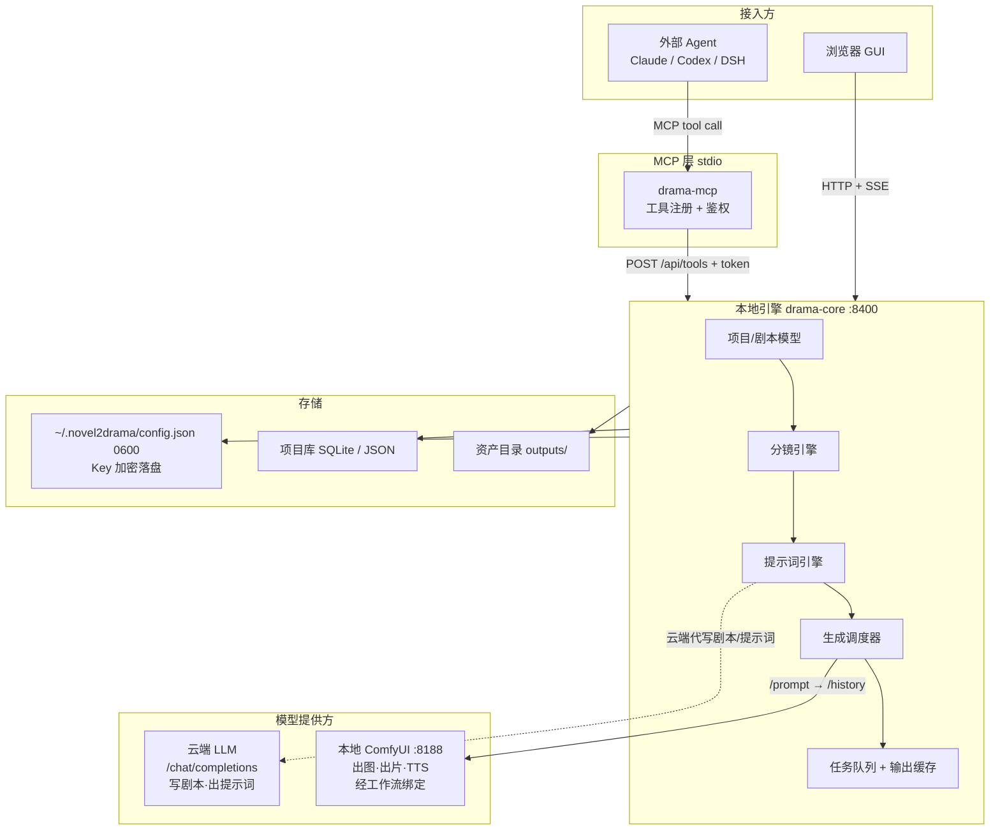

# 文本转短剧 · 技术实现方案

> 参考原型：`D:\AI\_lic_probe`（无界工作台 = 无限画布 + ComfyUI 网关 + canvas-agent）
> 目标产品：**任何文本 → 短剧** 的一体化本地工作台（不限小说）
> 状态：方案文档 v0.1（2026-11-10）

---

## 0. 一句话定位

把一段**文本**拆成**分集剧本 → 分镜 → 角色设定 → 图/视频提示词 → 配音 → 成片**，中间每一步都能：
1. 由**外部 Agent（MCP）**驱动；
2. 或由**LLM 后端**代写（OpenAI 兼容，云端或本地均可，见 §5.2）；
3. 所有生成参数在 **GUI** 里可改、可存预设、可回滚。

> 输入源不限小说：小说 / 短故事 / 剧本 / 大纲 / 新闻都行，见 README「输入源」。

---

## 1. 从参考项目继承什么、改什么

参考项目是「画布 + ComfyUI 网关」。我们不复制它的领域逻辑，**继承的是三层骨架**。

| 层 | 参考实现 | 本项目的用法 | 是否直接复用 |
|---|---|---|---|
| MCP 接入 | `infinite-canvas/canvas-agent/src/server/mcp.ts` | 外部 Agent 操作项目 | ✅ 模式直接照搬 |
| 工具契约 | `canvas-agent/src/canvas/schemas.ts` | `story_*` / `shot_*` / `prompt_*` 工具集 | 🔧 换 schema |
| 本地 HTTP 桥 | `canvas-agent/src/server/http.ts`（`POST /api/tools` + token） | MCP ↔ 引擎的转发层 | ✅ 结构复用 |
| 配置与密钥 | `canvas-agent/src/config.ts`（0600，用户目录） | 项目配置 + API Key 存储 | ✅ 复用 |
| 提示词优化 | `comfyui-gateway/src/prompt-optimizer.js` | 提示词引擎核心 | 🔧 改造 |
| Key 下发 | `comfyui-gateway/src/server.js:1099-1109` | 内部填 Key 的落盘流程 | ✅ 复用 |
| 工作流即模型 | `workflows/registry.json` + `bindings.js` | 生成器注册表（图/视频/语音） | 🔧 概念复用 |
| 任务制 | `tasks.js`（异步 + 输出缓存） | 长任务（整集生成） | ✅ 复用 |
| 前端 | `infinite-canvas/web`（React19+Vite+Zustand） | 主工作台 GUI | 🔧 换页面 |

**不继承**：ComfyUI 模型探测/资源安装/更新器/启动器接管。
出图出片走**本地 ComfyUI**、配音走**本地 IndexTTS 2.5 独立服务**、超分走 **Video2X CLI**（见 §7）。
模型与进程的启停由用户手动管理，本项目只调 API，不管装模型。

> ⚠️ 云端出图/出片**不在方案内**：全案「不设金额闸门」的前提是本地生成零边际成本，
> 走云端 API 会引入付费问题。云端只用于 LLM（文本/提示词）。

---

## 2. 总体架构



### 2.1 端口划分

| 服务 | 端口 | 说明 |
|---|---|---|
| `drama-core` | 8400 | 主引擎，HTTP + SSE |
| `drama-mcp` | — | stdio，不占端口 |
| GUI dev | 3400 | 前端开发服 |
| ComfyUI（可选） | 8188 | 仅当启用本地后端 |

### 2.2 进程模型

```
drama-core（常驻，Express 5）
  ├─ 内嵌 GUI 静态托管（生产）
  ├─ /api/*      业务接口
  ├─ /api/tools  MCP 转发入口（token 鉴权）
  └─ /v1/*       OpenAI 兼容出图/出片（可选，见 §7.3）

drama-mcp（按需，stdio）
  └─ 启动时读 ~/.novel2drama/config.json 取 url + token，转发到 drama-core
```

**关键设计：MCP 层不做业务。** 它只是 schema + 转发，和参考项目的 `mcp.ts` 完全一致。这样 GUI 和 Agent 走同一套业务接口，不会出现两套逻辑漂移。

---

## 3. 领域模型

### 3.1 核心实体

```ts
// 项目
Project {
  id: string
  title: string
  source: {                      // 源文本（不限小说）
    fileName?: string
    text: string
    encoding: "utf-8" | "gbk"
    charCount: number
    sourceKind: SourceKind       // 用户指定或嗅探结果
    detectedKind?: SourceKind    // 嗅探出来的，可能与用户指定不同（供 GUI 提示）
    units: SourceUnit[]
  }
  settings: ProjectSettings      // 见 §6
  episodes: Episode[]
  characters: Character[]
  assets: Asset[]                // 见下方 Asset
  llmUsage: { tokensIn: number; tokensOut: number; budget: number }
  createdAt, updatedAt
}

type SourceKind = "novel" | "story" | "script" | "outline" | "news" | "other"

// 文本单元（小说=章，故事=段，剧本=场；不是「章节」）
SourceUnit {
  index: number
  title: string
  range: [number, number]        // 源文本字符区间
  synthetic: boolean             // true = 按字数硬切出来的，不是自然单元
}

// 分集
Episode {
  id: string
  index: number
  title: string
  summary: string                // 集纲
  sourceRange: [number, number]  // 源文本字符区间
  scenes: Scene[]
  status: "draft" | "reviewed" | "locked"
}

// 场
Scene {
  id: string
  index: number
  location: string
  timeOfDay: string
  characters: string[]           // characterId
  action: string                 // 动作描述
  dialogue: DialogueLine[]       // 台词挂在场级，用 shotId 关联到具体镜头
  shots: Shot[]
}

// 台词（配音的最小单位）
DialogueLine {
  id: string                     // 全局唯一，配音产物按这个 id 存
  index: number
  speakerId: string              // characterId
  text: string
  emotion: Emotion               // 8 维枚举之一或 "auto"
  strength: number               // 0–1
  durationFactor: number         // 0.5–2.0
  shotId?: string                // 落在哪个镜头；undefined = 尚未分配到镜头
  audioAssetId?: string          // 配音产物
  actualSec?: number             // TTS 实测时长（算帧数用这个，不是估算）
  audioStale?: boolean           // 改过 text/emotion 后置 true，提示需重配
}

// 分镜
Shot {
  id: string
  index: number
  durationSec: number            // D，5–15 整数秒（H3 约束）
  actualDurationSec?: number     // 帧对齐后的实际时长（回显）

  // ── 画面事实 ──
  shotSize: ShotSize             // 远景/全景/中景/近景/特写
  cameraMove: CameraMove         // 固定/推/拉/摇/移/跟
  facing: FacingConstraint       // 朝向三要素：相对镜头/画框左右/两人关系
  initialPosition: string        // 第 0 秒初始空间位置（从事实重建，不沿用上镜画面）
  description: string            // 画面描述（中文，给人看）

  // ── 提示词（结构化，不是字符串）──
  taskType: TaskType             // 六种之一，见 §7.4
  promptVideo: VideoPrompt       // 见下方，按壳分型
  promptImage?: ImagePromptSet   // 图提示词（多种引擎各一份）
  negativePrompt: string

  // ── 内容策略 ──
  contentPolicy: "sfw" | "nsfw"
  intensityLevel?: "L0"|"L1"|"L2"|"L3"|"L4"|"L5"   // 仅 NSFW
  moduleTypes?: ("M1"|"M2"|"M3"|"M4"|"M5")[]        // 仅 NSFW
  bodyState?: BodyStateGradient[]                    // 仅 NSFW
  mediaLock: MediaType           // anime/2.5D/realistic/illustration，锁定介质

  // ── 引用（只有编号，不复述）──
  refCharacters: string[]        // characterId
  refAssets: string[]            // 首帧/尾帧/参考图 → assetCode
  pictureIndex: Record<string, string>  // { "<Picture 1>": "CH-01", "<Picture 2>": "SC-03" }

  // ── 结果 ──
  params: GenerationParams       // 见 §6.2
  status: "pending" | "generating" | "done" | "failed"
  candidates: string[]
  selectedAssetId?: string
  outputs: string[]
  riskScore?: number             // 0/1/2，2 = 不许出片
}

// 视频提示词：按壳分型，不用扁平字符串
//
// 壳由「素材构成」决定，不是 task_type 的简单函数：
//   有 <Subject N> / <Picture N> 参考归因 → 六段壳
//   只有一张首帧或纯文本               → 三字段壳
//
// 命名说明：
//   六段壳 = 6 个正文字段 + 1 条技术排除行（exclusionLine 是附加行，不计入"六段"）
//   三字段壳 = 3 个正文字段 + 1 条可选指令行 + 技术排除行（overall_soundscape / non_diegetic_music
//              虽写在同一壳里，但在官方术语里属于"三字段"这一族的成员）
type VideoPrompt =
  | { shell: "six-section"; ...SixSectionShell }   // ref2va / hybrid
  | { shell: "three-field"; ...ThreeFieldShell }   // t2va / i2va / l2va / fl2va

SixSectionShell {
  // 六个正文字段，顺序固定
  subjectDefinitions: string     // <Subject N> / `first_frame` / `last_frame` 定义行
  summary: string                // [keyframe completion | reference generation | ...]
  retentionAnalysis: string      // 每条 fully_preserved / partially_preserved / ...
  detailedDescription: string    // [Shot N] At MM:SS.mmm, ...
  overallSoundscape: string
  nonDiegeticMusic: string
  // 附加行（不属于六段，位于最末）
  exclusionLine: string          // No subtitles, no watermarks, ...
}

ThreeFieldShell {
  // 正文
  instructionLine?: string       // i2va 及变体有；t2va 无
  integratedMultimodalDescription: string
  overallSoundscape: string
  nonDiegeticMusic: string
  // 附加行
  exclusionLine: string
}
```

> **`fl2va` 的壳**：它挂 `first_frame` + `last_frame` 两个关键帧锚点，但**没有 `<Subject N>` / `<Picture N>` 参考归因**，所以用三字段壳。
> 关键帧锚点通过 `instructionLine` 表达（`first_frame is fully referenced at 0.00s` / `ends exactly on last_frame`）。
> **判据**：壳取决于「有无参考归因段」，`ref2va` / `hybrid` 必为六段，其余四种为三字段；与 `task_type` 只是间接对应。

```ts
// 角色
Character {
  id: string
  name: string
  aliases: string[]
  gender, age, appearance, outfit, personality
  portraitAssetId?: string       // 定妆照
  voiceProfile?: VoiceProfile    // 见下方
  consistencySeed?: number       // 角色一致性锚点
}

// 音色绑定（让 agent 不必每次手动背音色表）
VoiceProfile {
  voiceId: string                // voices/ 下的文件名（不含扩展名）
  refAudioPath: string           // 参考音频绝对路径
  language: "ZH" | "EN" | "JA" | "ES" | "AR"
  defaultEmotion: Emotion
  durationFactor: number
  createdAt: number
}

// 资产（所有生成/上传产物的统一结构）
Asset {
  id: string
  kind: "image" | "video" | "audio" | "portrait"

  // ── 全局编号（一经分配永不改变）──
  assetCode?: string             // "SC-01" | "CH-01" | "PR-01"
  variant?: "A" | "B" | "C"      // 状态变体：SC-01-A(白天)/B(黑夜)/C(损毁)
  // 完整标识 = assetCode + (variant ? `-${variant}` : "")，如 "SC-01-B"

  // ── 素材角色（决定进 <Subject N> 还是 <Picture N>）──
  role?: "identity"      // 身份源：完整继承人物
       | "wardrobe"      // 服装/道具参考
       | "scene"         // 场景/构图参考
       | "pose"          // 动作/姿态参考
       | "keyframe"      // 关键帧（first_frame / last_frame），不占 <Picture N> 号
       | "interactive"   // 匿名互动角色，仅保留身体轮廓

  path: string                   // 绝对路径
  url: string                    // 本服务可访问的 URL（/api/files/...）
  mimeType: string
  size: number
  sha256: string

  // ── 媒体属性（按 kind 取舍）──
  width?: number
  height?: number
  durationSec?: number
  sampleRate?: number
  channels?: number
  frameCount?: number
  fps?: number

  // ── 介质锁定（出图/出片一致性）──
  mediaType?: MediaType          // anime / 2.5D / realistic / illustration

  // ── 来源 ──
  source: "generated" | "uploaded" | "derived"
  parentAssetId?: string
  workflowId?: string
  seed?: number
  params?: Record<string, unknown>
  shotId?: string
  dialogueLineId?: string
  createdAt: number
}

// 全局资产清单：@图片N ↔ 资产编号 ↔ 用于哪些分镜
AssetManifest {
  items: {
    pictureAlias: string         // "@图片1"
    assetCode: string            // "CH-01"
    variant?: string
    usedInShots: string[]        // ["S01","S02","S05"]
  }[]
}

type MediaType = "anime" | "2.5D" | "realistic" | "illustration"

type Emotion = "auto" | "happy" | "angry" | "sad" | "afraid"
             | "disgusted" | "melancholic" | "surprised" | "calm"
```

### 3.1.1 资产编号规则

来源 `_原文摘录\13_分镜总控v9_全文.md` PART 5.1，**全局固定，一经分配永不改变**：

| 类 | 格式 | 状态变体 |
|---|---|---|
| 场景 | `SC-01` | `SC-01-A`(白天) / `B`(黑夜) / `C`(损毁) |
| 人物 | `CH-01` | 多状态（变身/龙化/离析前后）：`CH-01-A/B` |
| 道具 | `PR-01` | 同理 |

**分配顺序**：按资产在分镜中**首次出现顺序**；先人物/场景，后道具。

**硬规则**：

- 分镜里只写编号，**不重复描述**资产（单点定义）
- 同一张图在所有分镜中**永远是同一个 `@图片N`**
- `<Picture N>` 按给图顺序连续编号，**关键帧不占号**（走 `first_frame`/`last_frame` 字段名）
- 编号总数 = 用户本次给的关键图张数

### 3.2 存储选型

| 数据 | 存储 | 理由 |
|---|---|---|
| 配置 + Key | `~/.novel2drama/config.json` | 0600；Key 单独加密字段 |
| 项目元数据 | SQLite（`better-sqlite3`） | 单机、事务、可查 |
| 小说原文 + 剧本 | 项目目录内 `.md` / `.json` | 方便用户手改、可 git |
| 资产（图/视频/音频） | 项目目录 `assets/` + 索引 JSON | 大文件不入库 |

**不选浏览器 IndexedDB 做主存**（参考项目那样）。原因是 Agent 也要读写项目，主存必须落在文件系统。

---

## 4. MCP 接入层（重点一）

### 4.1 设计原则

1. **stdio 传输**：和参考项目一致，Agent 侧零配置。
2. **工具即用例**：每个工具对应一个完整业务动作，不做过度细粒度。
3. **幂等**：所有写工具带 `requestId`，重放不重复执行。
4. **可观测**：每次调用落审计日志（工具名、入参摘要、耗时、结果码）。
5. **不暴露密钥**：工具永远不返回 Key，也不接受 Key 参数。

### 4.2 工具清单（v1）

分四组：

**项目组**
| 工具 | 作用 |
|---|---|
| `project_create` | 建项目，导入**源文本**（不限小说） |
| `project_list` | 列项目 |
| `project_get` | 取项目全貌（可裁剪 detail） |
| `project_import` | 追加/替换原文 |
| `project_export` | 导出剧本包（md/json/srt） |

**剧作组**
| 工具 | 作用 |
|---|---|
| `source_analyze` | 划分文本单元、提取人物、情节线（旧名 `novel_analyze`） |
| `episode_plan` | 生成分集大纲 |
| `scene_breakdown` | 集 → 场拆分 |
| `shot_plan` | 场 → 分镜（含时长、景别） |
| `dialogue_polish` | 台词润色 |

**提示词组**
| 工具 | 作用 |
|---|---|
| `prompt_build_image` | 由分镜生成图提示词 |
| `prompt_build_video` | 生成视频提示词（含镜头运动） |
| `prompt_review` | 提示词质检（一致性/可生成性） |

**生成组**
| 工具 | 作用 |
|---|---|
| `generate_shot` | 触发单个分镜出图/出片 |
| `generate_episode` | 整集批量 |
| `generation_status` | 查任务状态 |
| `asset_list` / `asset_get` | 资产 |

**只读优先原则**：`plan/analyze/review/build` 全部只读或只写草稿；`generate_*` 虽然是本地出图（0 边际成本），但要占用 GPU 与队列，因此需要显式 `confirmRun: true` 才执行，否则先返回预估耗时与显存占用让你决定。

### 4.3 MCP 服务实现骨架

```ts
// apps/mcp/src/server.ts
import { McpServer } from "@modelcontextprotocol/sdk/server/mcp.js";
import { StdioServerTransport } from "@modelcontextprotocol/sdk/server/stdio.js";
import { loadConfig } from "./config.js";
import { toolNames, toolInputSchemas, toolDescriptions } from "./schemas.js";

export async function startMcpServer() {
  const config = loadConfig(true);
  const server = new McpServer(
    { name: "text-to-drama", version: VERSION },   // 旧名 novel-to-drama 作为兼容别名
    { instructions: AGENT_INSTRUCTIONS },
  );
  for (const name of toolNames) registerTool(server, config, name);
  await server.connect(new StdioServerTransport());
}

function registerTool(server, config, name) {
  const schema = toolInputSchemas[name];
  server.registerTool(name, {
    description: toolDescriptions[name],
    inputSchema: schema.shape,
  }, async (input) => {
    const result = await callTool(config, name, schema.parse(input));
    return { content: [{ type: "text", text: JSON.stringify(result, null, 2) }] };
  });
}

async function callTool(config, name, input) {
  const res = await fetch(`${config.url}/api/tools`, {
    method: "POST",
    headers: {
      "content-type": "application/json",
      "x-drama-token": config.token,
    },
    body: JSON.stringify({ name, input }),
  });
  const body = await res.json();
  if (!body.ok) throw new Error(body.error || "tool call failed");
  return body.result;
}
```

### 4.4 鉴权与安全

- token：`crypto.randomBytes(18).toString("hex")`，存 `~/.novel2drama/config.json`，文件 0600。
- `drama-core` 只绑 `127.0.0.1`；`/api/tools` 校验 `x-drama-token` + `Origin` 白名单。
- 跨站写请求（`Sec-Fetch-Site: cross-site`）一律 403 —— 这条直接抄参考项目。
- 审计日志：`~/.novel2drama/logs/tools-YYYYMMDD.jsonl`。

### 4.5 Agent 接入说明（给外部 Agent 的 prompt）

`apps/mcp/agent-instructions.md` 里写清楚：
- 先用 `project_get` 摸清现状，不要盲写；
- 任何 `generate_*` 前先跑 `prompt_review`；
- 批量生成前先 `generation_status` 确认没有在跑的任务；
- 不要一次性生成整集，按场推进，每场后汇报。

---

## 5. 提示词引擎（重点二）

### 5.1 引擎选择：`llm` 或 `template`

```
PromptEngine
 ├─ engine: "llm"       走 §5.2 的 llmBackends，按 role 路由（默认）
 └─ engine: "template"  纯规则模板拼接，不调任何模型
```

**没有 `cloud` / `local` 这种叫法了。** 云端还是本地由 `llmBackends` 里的后端决定，
不是引擎模式——同一个 `engine: "llm"` 既可以打 DeepSeek，也可以打本地 Ollama。

`template` 只做机械拼接（把角色锚点、风格锚、镜头描述按固定模板组合），
**不承担理解任务**。理解/改写一律走 `llm`，没有 `llm` 就报错，不降级到 `template`。

> 历史遗留：旧版文档里的 `mode: "cloud" | "local" | "comfy"` 三模式已废弃。
> `comfy`（ComfyUI 内置 Qwen 节点做提示词）也不做了——提示词是文本活，没必要排队等 GPU。

### 5.2 LLM 调用核心（多后端，OpenAI 兼容）

**不区分云端和本地。** 只认 OpenAI 协议，形如：

```
{ baseUrl, apiKey, model }  →  POST {baseUrl}/chat/completions
```

#### 后端配置表

```json
{
  "llmBackends": [
    { "id": "deepseek", "baseUrl": "https://api.deepseek.com/v1",
      "apiKey": "sk-...", "model": "deepseek-chat",
      "roles": ["text", "prompt"], "priority": 1, "enabled": true },
    { "id": "local-qwen", "baseUrl": "http://127.0.0.1:11434/v1",
      "apiKey": "ollama", "model": "qwen2.5:14b",
      "roles": ["prompt"], "priority": 2, "enabled": true }
  ],
  "roleRouting": { "text": "deepseek", "prompt": "local-qwen" }
}
```

**角色**：`text`（文本理解/改写）、`prompt`（提示词）、`plan`（分镜规划）。
`roleRouting` 显式指定；没配就按 `priority` 升序取第一个 `enabled` 且含该角色的。

本地后端的 `apiKey` 随便填（Ollama 用 `"ollama"`），协议要求有这个字段而已。

#### 内网地址策略要改

参考实现里 `assertCloudBaseUrl` 拒绝 loopback / 内网 / link-local，理由是防止 SSRF。
**这和「能接本地 Ollama」直接冲突，必须改。**

新策略：**按后端显式声明**，不靠猜地址。

```ts
type Backend = {
  id: string;
  baseUrl: string;
  apiKey: string;
  model: string;
  roles: Role[];
  priority: number;
  enabled: boolean;
  /** 声明这是本地后端，允许 loopback / 私网地址 */
  local: boolean;
};

function assertBaseUrl(b: Backend) {
  const u = new URL(b.baseUrl);

  // 先查协议（安全默认：不认识的协议直接拒，别先做内网判断）
  if (!["http:", "https:"].includes(u.protocol)) {
    throw new PromptError(`不支持的协议 ${u.protocol}`, { status: 400, code: "invalid_param" });
  }

  if (isPrivateAddress(u.hostname) && !b.local) {
    throw new PromptError(
      `后端 ${b.id} 指向内网地址 ${b.baseUrl}，但未标记为本地后端。` +
      `如果你确实要接本地模型（Ollama/LM Studio），把该后端的 local 设为 true。`,
      { status: 400, code: "llm_private_url" }
    );
  }
}

/**
 * 判断主机名是否指向本机/内网。
 * 用 ipaddr.js 的 range() 分类，不要手写正则——手写极易漏网段。
 *
 * ipaddr.js range() 返回: 'unicast' | 'unspecified' | 'broadcast' |
 *   'multicast' | 'linkLocal' | 'loopback' | 'private' |
 *   'reserved' | 'carrierGradeNat' | 'uniqueLocal' | 'ipv4Mapped' | ...
 *
 * 覆盖的网段（实测过每一条）：
 *   127.0.0.0/8           loopback
 *   10.0.0.0/8            private
 *   172.16.0.0/12         private
 *   192.168.0.0/16        private
 *   169.254.0.0/16        linkLocal   ← 旧正则漏了这个
 *   100.64.0.0/10         carrierGradeNat（Oracle/云内网）← 旧正则漏了这个
 *   0.0.0.0/8             unspecified ← 旧正则漏了这个
 *   ::1                   loopback
 *   fc00::/7              uniqueLocal (IPv6)
 *   fe80::/10             linkLocal (IPv6)
 *   ::ffff:a.b.c.d        ipv4Mapped，取出内嵌 IPv4 再判一次
 */
function isPrivateAddress(hostname: string): boolean {
  const bare = hostname.replace(/^\[|\]$/g, "");   // new URL 会把 IPv6 包在 [] 里
  if (bare === "localhost") return true;

  if (net.isIP(bare) === 6 && /^::ffff:/i.test(bare)) {
    // IPv4-mapped 的 IPv6，取内嵌部分重判
    const v4 = bare.split(":").pop()!;
    if (net.isIP(v4) === 4) return isPrivateAddress(v4);
  }
  if (!net.isIP(bare)) return false;               // 域名（api.deepseek.com 等）

  const range = ipaddr.parse(bare).range();
  return [
    "loopback", "private", "linkLocal", "uniqueLocal",
    "carrierGradeNat", "unspecified", "reserved",
  ].includes(range);
}
```

**为什么这样设计**：SSRF 防护的出发点是「用户不该被诱导去访问内网服务」。
但本地模型是**用户自己主动配的**，不是被诱导的。用显式 `local: true` 标记，
既保留了防护（外部地址伪装内网仍被拦），又让本地后端能正常用。

#### 调用实现

```ts
function pickBackend(role: Role): Backend {
  // 先判「有没有启用的后端」——这跟「该角色没后端」是两回事，错误提示不一样
  const enabled = backends.filter(b => b.enabled);
  if (enabled.length === 0) {
    throw new PromptError("没有任何启用的 LLM 后端，请先在设置页配置",
      { status: 400, code: "llm_no_backend" });
  }

  // 优先显式路由
  const routed = cfg.roleRouting[role];
  if (routed) {
    const b = enabled.find(x => x.id === routed);
    if (b && b.roles.includes(role)) return b;
    // 路由指向了不存在的/不干这活的后端 → 视同没配
  }

  // 退而求其次：按 priority 升序取第一个能干这活的
  const candidates = enabled
    .filter(b => b.roles.includes(role))
    .sort((a, b) => a.priority - b.priority);
  if (candidates.length === 0) {
    throw new PromptError(
      `角色 ${role} 没有可用后端。已启用的后端能干的活：` +
      enabled.map(b => `${b.id}(${b.roles.join(",")})`).join(" / "),
      { status: 400, code: "llm_no_role" });
  }
  return candidates[0];
}

async function llmChat({ role, system, userText, signal, temperature = 0.6, maxTokens = 4096 }) {
  const backend = pickBackend(role);
  assertBaseUrl(backend);

  const endpoint = backend.baseUrl.replace(/\/$/, "") + "/chat/completions";
  const controller = new AbortController();
  const timer = setTimeout(() => controller.abort(new Error("LLM 调用超时")), 120_000);

  try {
    const r = await fetch(endpoint, {
      method: "POST",
      headers: {
        "Content-Type": "application/json",
        "Authorization": `Bearer ${backend.apiKey}`,
      },
      body: JSON.stringify({
        model: backend.model,
        messages: [
          { role: "system", content: system },
          { role: "user", content: userText },
        ],
        temperature,
        max_tokens: maxTokens,
      }),
      signal: controller.signal,
    });

    if (r.status === 401 || r.status === 403) {
      throw new PromptError(`后端 ${backend.id} 认证失败`, { status: 502, code: "llm_auth" });
    }
    if (r.status === 404) {
      // 模型名不对时，多数实现返回 404
      throw new PromptError(`模型 ${backend.model} 在后端 ${backend.id} 上不存在`,
        { status: 502, code: "llm_model_not_found" });
    }
    if (!r.ok) {
      const body = await r.text().catch(() => "");
      throw new PromptError(`后端 ${backend.id} 返回 ${r.status}: ${body.slice(0, 500)}`,
        { status: 502, code: "llm_unreachable" });
    }
    return await r.json();
  } finally {
    clearTimeout(timer);
  }
}
```

**不做本地兜底**：`pickBackend` 抛错就直接向上抛，**不降级成 `template` 规则拼接**。
这是刻意设计——降级出来的结果质量差到用户无法判断，比明确报错更糟。
区分两个码：`llm_no_backend`（一个能用的后端都没有）vs `llm_no_role`（有后端但这个角色没人干）。

**必须保留的三条经验**（来自参考项目踩过的坑）：
1. **私网地址防护**：见 §5.2 的 `local: true` 显式声明。外部地址伪装内网仍被 `llm_private_url` 拦下，
   本地后端必须由用户主动标记才能用 loopback/私网地址。
2. **temperature 重试**：部分模型只接受 `temperature=1`，按报错文案重试一次，不维护模型白名单。
3. **思考块剥离**：模型输出常带 `<think>` 或「思考过程：」，必须清洗后再当提示词用（见 §5.4）。

### 5.3 Skill 文件体系

> **2026-11-10 重规划**：原来的四组目录是照搬参考项目写的，`references/` 里的文件名（`character-extract.txt`、
> `camera-motives.txt`、`motion-vocab.txt`）在 `_原文摘录\` 里**一个都不存在**；反过来，摘录里的
> 8 类动作库、L0–L5 档位、六段壳这些真东西**没进任何 skill**。两边对不上，已按实际内容重排。

#### 5.3.1 三层结构：骨架 / 策略 / 主题

**不再按「功能」切（analyze / shot-design / prompt-image），按「变更频率」切。**

```
prompts/
├── base.md                    # 共用骨架，约 70%，改它影响所有模式
│   ├── 角色设定与身份
│   ├── 输入处理（三情况）
│   ├── 全局生成规格（含剧本一致性、Facing）
│   ├── 分镜与镜头体系（Shot / Cut）
│   ├── 运镜六条 + 摄像机归因纪律
│   ├── 台词规则（配额、口型、音色）
│   ├── 声音设计
│   └── 自检清单骨架
│
├── shells/                    # 输出壳，按 task_type 选，互斥
│   ├── six-section.md         # ref2va / hybrid：六个 body 字段 + exclusionLine
│   └── three-field.md         # t2va / i2va / l2va / fl2va：指令行 + 三字段
│
├── policy-sfw.md              # SFW 策略片段
│   ├── 表演描述规范
│   ├── 神情渐变（通用版）
│   ├── 介质措辞
│   └── 负面词 ①②③⑤⑥
│
├── policy-nsfw.md             # NSFW 策略片段
│   ├── L0–L5 档位表
│   ├── M1–M5 模块
│   ├── 8 类动作库
│   ├── 7×5 状态梯度
│   ├── 解剖术语 + 禁用代称
│   └── 负面词 ①②③④⑤⑥（④ 只在 NSFW 填）
│
└── themes/                    # 主题包，可选，叠加在上面三层之上
    └── tk.md                  # TK 主题：写作流 + 专属词表
```

**三层职责**：

| 层 | 什么时候改 | 谁改 |
|---|---|---|
| `base.md` | 极少改，改了全局生效 | 本鲸（开发） |
| `shells/*.md` | 跟着 H3 引擎版本走 | 本鲸（对照 `conditioning.py`） |
| `policy-*.md` | 调尺度、调措辞 | 本鲸 + 用户覆盖 |
| `themes/*.md` | 加新题材 | 用户自己写 |

#### 5.3.2 为什么不用原来的四组

| 原设计 | 问题 |
|---|---|
| `novel-analyze/` + `character-extract.txt` + `plot-beats.txt` | 分析指令是**代码逻辑**（切场景、抽人物、建资产表），不是提示词。放进 skill 是错位 |
| `shot-design/` + `shot-sizes.txt` + `camera-motives.txt` | 景别与运镜语义**已经写在 `分镜系统规则.md` 和 `H3提示词规则.md` §5.1**，再抄一份必失同步 |
| `prompt-image/` + `style-anchor.txt` | 风格锚是**项目级数据**（每部片一份），不是内置知识，应在 `projects/<id>/style-anchor.md` |
| `prompt-video/` + `motion-vocab.txt` | 运镜词表同上，已在上位文档里 |

**根因**：原设计把「**知识**」和「**指令**」混在一个目录里。知识（词表、枚举、规则）应当有唯一出处（上位文档），skill 只放**要交给模型的指令文本**。

#### 5.3.3 加载顺序（按此拼装，不可乱序）

```ts
function assembleSkill(mode: "sfw" | "nsfw", taskType: TaskType, theme?: string): string {
  const parts = [
    read("base.md"),                                   // 1. 骨架，永远第一
    read(`shells/${shellFor(taskType)}.md`),           // 2. 壳，二选一
    read(`policy-${mode}.md`),                         // 3. 策略，与模式绑定
  ];
  if (theme) parts.push(read(`themes/${theme}.md`));   // 4. 主题，可选，最后叠
  return parts.join("\n\n---\n\n");
}
```

**顺序理由**：壳必须紧跟骨架（它定义输出结构，属于「怎么写」），策略在壳之后（它定义「写什么内容」，是填充），主题最后（它只改局部措辞）。

#### 5.3.4 与 `_原文摘录\` 的关系

**摘录是资料库，不是运行时依赖。** 两者分工：

| | `_原文摘录\`（15 份） | `prompts/`（运行时） |
|---|---|---|
| 性质 | **参考资料**，原文逐字 | **生产用提示词**，经过裁剪 |
| 谁读 | 本鲸写文档时 | 程序运行时 |
| 变不变 | 不变（是历史存档） | 会随版本迭代 |
| 引用方式 | 记行号，可回查 | 直接读文件 |

**不做的事**：不把摘录文件直接当 skill 用。它们有 687–2066 行，塞进上下文会挤掉真正的任务内容。**skill 是从摘录里提炼出来的，不是摘录本身。**

#### 5.3.5 用户覆盖

```
prompts/                          ← 内置，随程序升级
projects/<projectId>/prompts/     ← 项目级覆盖，优先
~/.novel2drama/prompts/           ← 用户全局覆盖，次优先
```

**查找顺序**：项目级 → 用户全局 → 内置。同名文件后者被前者覆盖。

好处：用户想让某部片的 NSFW 尺度更含蓄，只改那一部片的 `policy-nsfw.md`，不动内置。

### 5.4 输出清洗（必须有）

```ts
const THINK_BLOCK_RE = /<(think|thinking|analysis|reasoning|scratchpad)(?:\s[^>]*)?>[\s\S]*?<\/\1>/gi;
const META_LINE_RE = /^(?:[-*#>\s]*)?(?:\*\*)?(?:思考过程|思考|分析|推理|说明|解释|备注|Thinking|Analysis)(?:\*\*)?\s*[:：]/i;

function stripReasoning(text: string): string {
  let out = String(text || "");
  out = out.replace(THINK_BLOCK_RE, "");
  out = out.replace(/<\|[^|]{1,60}\|>/g, "");
  out = out.replace(/^\s*```[a-zA-Z0-9_-]*\s*\n?/, "").replace(/\n?```\s*$/, "");
  return out.split(/\r?\n/).filter(l => !META_LINE_RE.test(l.trim())).join("\n").trim();
}
```

### 5.5 一致性保障（短剧的命门）

短剧最怕**角色长相前后不一致**。三层保障：

| 层 | 手段 |
|---|---|
| 文本层 | 每个角色固定一段 `appearanceLock`（发色/瞳色/服装/体态），所有提示词强制前置 |
| 图像层 | 角色定妆照 `portraitAssetId` 作为参考图传入；固定 `consistencySeed` |
| 提示词层 | 系列级 `style-anchor.txt` —— 画风、色调、胶片质感统一 |

生成时按「角色锁定块 + 场景描述 + 镜头参数 + 风格锚」拼接，顺序固定，不允许模型自由改序。

### 5.5.1 角色定妆照：透明底直出

定妆照是角色一致性的**图像锚点**，需要干净无背景。**Qwen Image 2.1 靠提示词就能直出带 alpha 的透明底 PNG，不需要抠图节点。**

已验证（详见 `Qwen透明图验证.md`）：背景 `A=0`、主体 `A=255`、半透明过渡占 48.4%，发丝通透无白边。

#### 提示词三段式

```
[1] 这是一张具有透明度的 RGBA 格式图像。
[2] [角色外观描述]，边界清晰、独立完整的完整人物主体。
[3] 该图像具有 alpha 通道，背景完全透明。
```

| 段 | 作用 |
|---|---|
| 开头 | 声明格式。模型对**前置指令**遵从度更高 |
| 中间 | 保证主体边界清晰。别写"风景里的人"这种无明确轮廓的内容 |
| 结尾 | 移除背景，防止模型脑补渐变底 |

负向词：`白色背景, 灰色背景, 影棚布景, 投影, 地面, 渐变背景`

#### GUI 交互

定妆照生成面板加一个勾选框：

```
☑ 透明底输出（RGBA）
  勾选后自动注入透明底提示词片段
```

勾选时拼接逻辑：

```ts
function buildPortraitPrompt(appearance: string, transparent: boolean) {
  if (!transparent) return { prompt: appearance, negative: "" };
  return {
    prompt: `这是一张具有透明度的 RGBA 格式图像。\n${appearance}，边界清晰、独立完整的完整人物主体。\n该图像具有 alpha 通道，背景完全透明。`,
    negative: "白色背景, 灰色背景, 影棚布景, 投影, 地面, 渐变背景",
  };
}
```

**负向词合并**，不覆盖用户自己填的。

#### 出图校验

收图后读 alpha 通道：透明像素占比低于 5% 判定失败，触发重生成。实测同提示词不同种子**偶发白底**，不能假设百分百成功。

#### 工作流要求

- 用文生图链路（`image-qwen21v2-t2i`），节点不变，只设提示词
- **`VAELoader` 必须是 `qwen_image_2.1_vae_bf16`** —— 这个 VAE 是四通道的，alpha 从它出来
- 普通 `SaveImage` 即可，不需要 `SaveImageWithAlpha`

#### 照片抠主体的已知问题

传入已有图片要求"去掉背景保留主体"这条路**在本机没打通**：Qwen edit 会**重画主体**而非精确抠图（粉发角色被画成黑发）。详见 `Qwen透明图验证.md` §5。

**当前策略**：定妆照直接透明底生成，不走"先生成再抠图"。真要处理已有图片，等超分/抠图方案回测后再定。

### 5.6 提示词引擎接口

```
POST /api/prompts/build
{
  "kind": "image" | "video",
  "shotId": "...",
  "engine": "llm" | "template",
  "options": { "style": "...", "language": "zh" | "en", "strict": true }
}
→ { "prompt": "...", "negative": "...", "meta": { "tokens": 0, "model": "..." } }

POST /api/prompts/review
{ "shotId": "...", "prompt": "..." }
→ { "score": 0-100, "issues": [{ "level": "warn", "code": "...", "message": "..." }] }
```

---

## 6. GUI 参数体系

### 6.1 页面结构

```
┌ 项目列表 ─────────────────────────────┐
│ 小说导入 │ 分集大纲 │ 分镜表 │ 角色 │ 生成 │ 导出 │
└───────────────────────────────────────┘
```

六个主页面，对应工作流六个阶段。**线性推进，但每页可回改**。

### 6.2 参数分组（GUI 里可改）

> **两层并存，不是二选一**（2026-11-10 定，解决冲突 ⑤）：
> **底层按技术分组存**（下面 A/B/C），**UI 层按「我想要 X」呈现**（§6.2.0）。
> 数据结构用技术分组，界面用意图分组，中间一张映射表。详见 §6.2.0。

#### 6.2.0 UI 层：按「我想要」组织（用户看到的）

用户想的是「节奏快点」「画面更稳」，不是「把 `globalSegDurationSec` 从 8 改成 6」。所以 UI 首屏给意图，不给参数名：

| 我想要… | 改哪个底层参数 | 怎么改 | 副作用（要提示） |
|---|---|---|---|
| **节奏更快** | `globalSegDurationSec` ↓ | 8 → 6 | 台词上限从 24 降到 18 字；动作槽从 5 降到 4 |
| **节奏更慢** | `globalSegDurationSec` ↑ | 8 → 10 | 台词上限升到 30；但单镜过长会考验模型稳定性 |
| **台词更多** | `dialogueRatio` ↑ + `globalSegDurationSec` ↑ | 0.4→0.55，同时 D +2 | 必须同时加时长，否则超字数 |
| **画面更稳** | `cameraStyle` = 电影感 + 禁慢镜 | `allowSlowMotion=false` | 运镜变少，画面偏静 |
| **更抓眼球** | `cameraStyle` = 网感 + 允许慢镜 | — | 运镜变多，15 秒内易晃 |
| **特写多一点** | `shotSizeBias` = 偏特写 | — | 全景交代变少，空间关系可能说不清 |
| **一集更短** | `episodeDurationSec` ↓ | 90 → 60 | **会挤掉剧情**，需人工确认砍哪段 |
| **尺度更大** | `mode` = nsfw + `nsfwLevel` | — | 走 `policy-nsfw.md`，合规门必过 |

**「副作用」列必须显示在 UI 上**，不能只改不告知。比如用户把节奏调到「更快」，却没看到台词上限掉了，回头发现台词被砍，会以为是 bug。

#### 6.2.1 两层怎么对应

```ts
/** 意图 → 底层参数的映射，UI 只认意图 */
interface PresetHint {
  id: string
  label: string                    // "节奏更快"
  changes: Array<{
    path: string                   // "shot.globalSegDurationSec"
    from: unknown
    to: unknown | ((cur: unknown) => unknown)   // 相对改，如 D - 2
  }>
  sideEffects: string[]            // UI 必须显示
  conflicts?: string[]             // 与哪些意图冲突
}

const PRESETS: PresetHint[] = [
  {
    id: "faster",
    label: "节奏更快",
    changes: [{ path: "shot.globalSegDurationSec", from: 8, to: (d) => Math.max(5, Number(d) - 2) }],
    sideEffects: ["台词上限每镜减少约 6 字", "动作槽每镜减少 1"],
  },
  {
    id: "more-dialogue",
    label: "台词更多",
    changes: [
      { path: "script.dialogueRatio", from: 0.4, to: 0.55 },
      { path: "shot.globalSegDurationSec", from: 8, to: (d) => Math.min(15, Number(d) + 2) },
    ],
    sideEffects: ["必须同时加时长，否则台词超字数"],
    conflicts: ["faster"],
  },
]
```

**校验**：应用意图后，用 §6.2.2 的底层表反查，若出现非法组合（如 D 超出 5–15）直接拒绝并说明。

#### 6.2.2 底层：技术分组（程序用的）

**A. 剧本参数（全局）**
| 参数 | 类型 | 默认 | 说明 |
|---|---|---|---|
| `episodeCount` | number | 自动 | 目标集数 |
| `episodeDurationSec` | number | 90 | 单集时长 |
| `genre` | enum | 都市/古风/悬疑/甜宠 | 题材 |
| `tone` | enum | 爽感/虐心/轻松 | 情绪基调 |
| `dialogueRatio` | 0-1 | 0.4 | 台词占比 |
| `language` | enum | zh | 输出语言 |

**B. 分镜参数**
| 参数 | 类型 | 默认 | 说明 |
|---|---|---|---|
| `globalSegDurationSec` | number | 5 | **D**，单镜目标时长，**5–15 整数秒**（H3 约束） |
| `perShotOverride` | Record<string,number> | `{}` | 单镜覆盖，如 `{"S03": 10}` |
| `shotSizeBias` | enum | 均衡 | 偏特写/偏全景 |
| `cameraStyle` | enum | 电影感/网感/纪实 | 运镜风格 |
| `allowSlowMotion` | bool | true | 是否允许慢镜 |

#### 6.2.3 时长级联公式（改 D 必须重算一切）

来源 `_原文摘录\13_分镜总控v9_全文.md` PART 6.2。**D 是主变量，其余全是它的函数。**

```
D_n = perShotOverride[Sn] ?? globalSegDurationSec
```

| # | 项 | 公式 |
|---|---|---|
| 1 | **时间码** | `start_n = Σ D(前序)`；`end_n = start_n + D_n`；全片连续、无缺口 |
| 2 | **模型上限切分** | `Mmax` = 目标模型单镜上限（H3 ≤15）。`D > Mmax` → 切 `k = ceil(D / Mmax)` 个子镜 |
| 3 | **台词预算** | 中文字数上限 `≈ floor(D × 3)`，**建议 `floor(D × 2.5)`**（向下取整） |
| 4 | **动作槽** | `slots = min(9, round(D × 0.6))` |
| 5 | **视觉节拍** | `≈ ceil(D / 4)` |
| 6 | **运镜预算** | 每节拍 ≤ 1 主运镜；单镜复杂运镜 ≤ 2 |
| 7 | **表情变化** | 单镜可见表情 1–3 个 |
| 8 | **同镜人数** | 可见人脸 ≤ 3 |
| 9 | **转场/声音点** | 与时间码对齐 |

**速算表**：

| D | 台词上限/建议 | 动作槽 | 节拍 |
|---|---|---|---|
| 5 | 15 / 12 | 3 | 2 |
| 6 | 18 / 15 | 4 | 2 |
| 8 | 24 / 20 | 5 | 2 |
| 10 | 30 / 25 | 6 | 3 |
| 12 | 36 / 30 | 7 | 3 |
| 15 | 45 / 37 | 9 | 4 |

**台词密度 → 拆条**（来源 `03_writing-conventions` §10）：

> 剧本有 N 句台词 → 该段**至少**需要 `ceil(N / 3)` 条（15 秒条按 3–4 句算）。
> **剧本是定数，条数与时长才是变量。** 装不下就加时长或拆条，**绝不删台词**。

**修改协议**：改 D 后必须逐项重算并在交付中体现，**禁止只改时间码尾数**。

**C. 生成参数**
| 参数 | 类型 | 默认 | 说明 |
|---|---|---|---|
| `imageWorkflow` | enum | `qwen21:t2i` | 出图工作流（见 §7.3 全清单） |
| `useVDN` | bool | true | VDN 加速链，缺 adapter 自动回退无 VDN |
| `characterSwap` | bool | false | 切到角色替换工作流 |

**C-1. 分镜素材标签（GUI 逐张标注，见 §7.4）**
| 参数 | 类型 | 默认 | 说明 |
|---|---|---|---|
| `refs[].role` | enum | `auto` | `first` 首帧 / `last` 尾帧 / `character` 角色参考 / `scene` 场景参考 / `auto` |
| `refs[].kind` | enum | `image` | image / video / audio |
| `durationSec` | number | 5.0 | **时长（秒）**，GUI 输入，内部转 `length` 帧（17n+5，封顶 362） |
| `frameMode` | enum | 推导 | `first`/`last`/`both`，由 refs 角色标签推导，不直接暴露 |
| `resolution` | enum | 1080x1920 | 竖屏短剧默认 |
| `fps` | enum | 24/30 | 帧率 |
| `aspect` | enum | 9:16 | 画幅 |
| `seed` | number | random | 种子（可锁定） |
| `consistencyStrength` | 0-1 | 0.8 | 角色一致性强度 |
| `vramGuardMB` | number | 1024 | 剩余显存低于此值暂停出队（本地保护） |
| `concurrencyCap` | number | 1 | 同时执行的工作流数（本地 GPU 串行更稳） |
| `maxQueueLength` | number | 20 | 队列上限，超出拒绝入队 |
| `llmTokenBudget` | number | 0（不限） | 剧本链路单项目 token 预算（云端 LLM 计费） |

**C-2. 2采参数（H3 视频专用）**
| 参数 | 类型 | 默认 | 说明 |
|---|---|---|---|
| `steps` | number | 8 | 总步数 |
| `transitionStep` | 1-7 | 6 | 低清→全清切换步（8步时最大7） |
| `lowresScale` | 0.25-1 | 0.6 | 低清阶段分辨率比例 |
| `rho` | 0-1 | 0 | 锚点校正 |
| `wMin` / `wMax` | 0-1 | 0.3 / 1 | 两阶段混合权重 |

**C-3. 超分参数（Video2X）**
| 参数 | 类型 | 默认 | 说明 |
|---|---|---|---|
| `upscaleProcessor` | enum | `realesrgan` | realesrgan / realcugan / libplacebo / rife |
| `upscaleModel` | enum | `realesrgan-plus` | 按处理器联动可选值 |
| `upscaleScale` | number | 2 | 放大倍数（与显式宽高二选一） |
| `upscaleDevice` | number | 1 | Vulkan 设备号，**本机必须填 1**（0 是核显） |
| `interpolateMul` | number | 0 | 插帧倍率，0 不插帧 |
| `upscaleCodec` | enum | `libx264` | 输出编码（可换 h264_nvenc） |

**D. 提示词参数**
| 参数 | 类型 | 默认 | 说明 |
|---|---|---|---|
| `engine` | enum | llm / template | 提示词引擎：LLM 生成 或 模板拼装（旧 cloud/local/comfy 已废弃） |
| `promptLanguage` | enum | zh/en | 提示词语言 |
| `styleAnchor` | string | — | 风格锚文本 |
| `negativeDefaults` | string[] | 内置 | 负面词 |
| `autoReview` | bool | true | 生成前自动质检 |

### 6.3 预设与继承

参数三层继承，优先级从低到高：

```
全局默认 → 项目设置 → 分集覆盖 → 分镜级覆盖
```

GUI 里每层都能改，改上层时提示「会影响 N 个下级项」。所有参数变更写 `param-history.jsonl`，支持回滚到任意历史点。

### 6.4 关键交互要求

1. **每次修改实时预览**：改 `resolution` 立刻显示尺寸比例框。
2. **资源预估常显**：生成按钮旁边显示「预计 32 秒 / 显存 6.2 GB · 队列 N 个」。剧本链路另显示 token 消耗。
3. **失败可重试单点**：分镜表里单个镜头失败能原地重试，不必重跑整集。
4. **参数差异高亮**：对非默认值打标记，一眼看出改了啥。

---

## 7. 生成后端

### 7.1 抽象接口

```ts
interface ImageProvider {
  id: string
  name: string
  capabilities: { maxBatch: number; supportsRef: boolean; sizes: string[] }
  estimateResource(req): { vramMB: number; durationMs: number }
  generate(req, signal): Promise<{ assets: Asset[] }>
}

interface VideoProvider {
  id: string
  name: string
  capabilities: { maxDurationSec: number; supportsRef: boolean; fps: number[] }
  estimateResource(req): { vramMB: number; durationMs: number }
  generate(req, signal): Promise<{ assets: Asset[] }>
}

/** 超分/插帧是独立后处理器，不走 ComfyUI（**视频**超分走 Video2X，见 §7.5）
 *  **图片**超分走 ComfyUI SeedVR2，是普通 ComfyUI 工作流，不是 PostProcessor，见 §7.3.1 */
interface PostProcessor {
  id: string
  name: string
  kind: "upscale" | "interpolate"
  capabilities: { factors: number[]; cpus: boolean; gpus: boolean }
  run(req, signal): Promise<{ asset: Asset; logs: string[] }>
}

/** 语音合成是独立服务，与图像/视频互斥占用 GPU */
interface VoiceProvider {
  id: string
  name: string
  capabilities: {
    languages: string[]
    emotions: string[]
    sampleRate: number
    maxBatch: number
    durationFactorRange: [number, number]
  }
  /** 语音必须排在视频前面：实测时长是算帧数的输入 */
  load(): Promise<{ warnings: string[] }>
  unload(): Promise<void>
  synthesize(req: { text: string; voice: string; emotion?: string; targetSec?: number },
             signal): Promise<{ asset: Asset; actualSec: number }>
}
```

### 7.2 后端分工（2026-11-10 确认）

| 环节 | 后端 | 说明 |
|---|---|---|
| 出图 | 本地 ComfyUI | **全部图片工作流都接**，不预设分工，GUI 里选 |
| 出片 | 本地 ComfyUI（H3 **2采**） | `SelfLiftH3Sampler` 两阶段采样 |
| **配音** | **IndexTTS 2.5 独立服务** (`:17863`) | 与 ComfyUI 显存互斥，手动装卸，见 §7.7 |
| 超分/插帧 | **Video2X 6.4.0 独立程序** | 不在 ComfyUI 内，走子进程 CLI |

### 7.3 图片工作流清单（全接）

按实际文件与 `registry.json` 核对，不是按名字猜：

| registry id | 标签 | 类型 | 说明 |
|---|---|---|---|
| `image-qwen21` | Qwen Image 2.1 | 多 variant | **t2i / edit / inpaint / outpaint / remove / angle** 五种，共 5 个文件 |
| `image-moss-sft-8step` | MOSS-Image 8步 | 文生图 | bf16 + Qwen3.5 INT8 CLIP + FLUX.2 VAE |
| `image-moss-sft-50step` | MOSS-Image 50步 | 文生图 | 同权重，不挂 8步 LoRA，TE-Speed 跳步 |
| `image-moss-sft-int8-8step` | MOSS int8 8步 | 文生图 | 低显存变体 |
| `image-moss-sft-int8-50step` | MOSS int8 50步 | 文生图 | 低显存 + SLG 第22层 |
| `image-krea2-turbo` | Krea2 Turbo | 文生图 | 8步蒸馏 |
| `image-krea2-aesthetics` | Krea2 Aesthetics | 文生图 | 两阶段 7+10 步（`hidden`） |
| `image-krea2-four-view` | Krea2 角色四视图 | 图生图 | 角色设定表（`hidden`） |
| `z-image-turbo` | Z-Image Turbo | 文生图 | — |
| `image-esrgan-upscale` / `image-seedvr2-upscale` | 图像超分 | 后处理 | `hidden`，但可当独立动作调用。**SeedVR2 见 §7.3.1，已实测跑通** |
| `image-idol-3d` / `image-moge-scene` | 图生 3D | 3D 重建 | `hidden`，短剧用不上，不接 |

**注意**：MOSS 和 Qwen 共用同一个文本编码器家族（Qwen3.5 / Qwen3-VL），但**不是同一个模型**——MOSS 是独立 UNET 走 FLUX.2 VAE，Qwen Image 2.1 是自己的 UNET + VAE。两者都接，让用户在 GUI 里按场景挑。

**接入策略**：全部注册进 provider 表，`hidden` 的默认不出现在模型下拉里，但可通过「显示全部」打开。

### 7.3.1 图片超分：SeedVR2 3B（2026-11-10 实测跑通）

> **本文档唯一一个「跑过真实图片、出过成品」的 ComfyUI 工作流。**其余环节多为参数摸清但端到端未验。
> 工作流文件：`workflows/image-seedvr2-upscale.api.json`（API 格式）+ 同名 `.ui.json`（画布格式）。

#### 为什么用 SeedVR2 而不是 ESRGAN

| 方式 | 本质 | 放大到 4 倍时 |
|---|---|---|
| RealESRGAN（`ESRGAN_图片放大x4.json`） | 纯卷积放大 | 线条会糊，细节是「插值猜的」 |
| **SeedVR2 3B**（本节） | **扩散模型重建** | 细节是「重新画出来的」，Anime 线稿不糊 |

短剧素材多是 AI 生成的动漫/半写实人物，**线条干净度是成败关键**，所以主用 SeedVR2，ESRGAN 只做兜底（快、轻、不占大显存）。

#### 节点链（5 节点，官方链）

```
LoadImage → SeedVR2VideoUpscaler → SaveImage
                ↑            ↑
      SeedVR2LoadDiTModel  SeedVR2LoadVAEModel
```

**关键：必须用 SeedVR2 官方三件套**（`SeedVR2LoadDiTModel` / `SeedVR2LoadVAEModel` / `SeedVR2VideoUpscaler`）。

> ⚠️ **踩过的坑**：旧的 `单图超分.json` 走的是 `UNETLoader` + `VAELoader` + `KSampler` 那套通用链，
> 引用的模型名是 `seedvr2_3b_nvfp4.safetensors` 和 `seedvr2_ema_vae_fp16.safetensors`。
> **这两个文件本机根本不存在**——`UNETLoader` 只查 `models/unet` 和 `models/diffusion_models`，
> 而 SeedVR2 权重放在 `models/SEEDVR2/`，通用加载器看不见。所以那条链是跑不起来的，已废弃重写。

#### 模型（磁盘实况，与 `model_registry.py` 默认值一致）

| 角色 | 文件名 | 位置 | 大小 |
|---|---|---|---|
| DiT | `seedvr2_ema_3b_fp8_e4m3fn.safetensors` | `models/SEEDVR2/` | 3.16 GB |
| VAE | `ema_vae_fp16.safetensors` | `models/SEEDVR2/` | 0.47 GB |

`models/SEEDVR2/` 由插件自己注册（`src/utils/constants.py` L49-50 调 `add_model_folder_path("seedvr2", ...)`），**不经过** `folder_paths.py` 写死的目录表。这是通用加载器找不到它的原因。

可选：7B 版更锐但显存吃紧，本机 8 G 卡不建议；GGUF 版（`seedvr2_ema_3b-Q4_K_M.gguf`）要另装 GGUF 节点包，当前未装。

#### 参数：`resolution` 是「目标短边」，不是倍率 ⚠️

**这是最容易理解错的一个参数。**

```
输入 1168×2016，resolution=1080 → 输出 1080×1864   ← 实际缩小了！耗时 41.6 s
输入 1168×2016，resolution=1440 → 输出 1440×2484   ← 真放大，耗时 111.1 s
```

`resolution` = 处理后**短边的目标像素数**，长边按原比例跟随。因此：

| 想要 | 怎么设 |
|---|---|
| 统一到 1080p 竖屏 | `resolution=1080` |
| 从 720p 提到 1080p | `resolution=1080` |
| 从 576p 提到 1440p | `resolution=1440` |
| 只是想把小图放大 | 设成**比原短边大**的值 |

**判据**：先读原图短边，再决定填多少。填小了就是缩图——不会报错，只会静默降分辨率。

#### 参数表（实测可行值）

| 参数 | 实测值 | 说明 |
|---|---|---|
| `seed` | 42 | 固定，便于复现 |
| `resolution` | 1080 / 1440 | 目标短边 |
| `max_resolution` | 4096 | 任一边上限，防极端长图爆显存 |
| `batch_size` | **1** | **静态图必须为 1**；大于 1 要满足 `4n+1`，是给视频多帧用的 |
| `uniform_batch_size` | false | 静态图无意义 |
| `temporal_overlap` | 0 | 静态图无意义 |
| `prepend_frames` | 0 | 静态图无意义 |
| `color_correction` | `lab` | 保细节最忠实；可选 `wavelet`/`wavelet_adaptive`/`hsv`/`adain`/`none` |
| `input_noise_scale` | 0.0 | 加噪会增加「想象」，静态图不要 |
| `latent_noise_scale` | 0.0 | 同上 |
| `offload_device` | `cpu` | 8 G 卡必须，否则 VAE 解码易 OOM |
| DiT `cache_model` | **true** | 批量超分时省掉重复加载（约 8 s） |
| DiT `offload_device` | `cpu` | `cache_model=true` 时必填，否则节点直接抛 ValueError |
| DiT `attention_mode` | `sdpa` | 稳定。`sageattn_3` 需另装包，RTX 50 系可用但未测 |
| VAE `encode_tiled`/`decode_tiled` | true | 1024 瓦片 / 128 重叠，8 G 卡必需 |

**注意 `cache_model=true` 的硬约束**：节点源码 L160-166 明确要求 `offload_device != "none"`，否则报错。这是显式的，不是默认兜底。

#### 性能实测（RTX 5070 Laptop 8 G）

| 场景 | 输入 → 输出 | 耗时 |
|---|---|---|
| 短边 1080（缩小） | 1168×2016 → 1080×1864 | 41.6 s |
| 短边 1440（放大） | 1168×2016 → 1440×2484 | 111.1 s |

**耗时随像素数近线性增长**。一集 60 镜的定妆照/场景板批处理要按分钟算，不是秒。

#### 与视频超分的关系

**两套完全不同的东西，不要混：**

| | 图片超分 | 视频超分 |
|---|---|---|
| 后端 | **ComfyUI**（SeedVR2） | **Video2X 独立程序**（§7.5） |
| 占显存 | 是，与生成任务互斥 | 是，与 ComfyUI 互斥 |
| 输入 | 单张静态图 | 视频文件 |
| 谁用 | 定妆照、场景板、道具图 | 成片 |

图片超分**在 ComfyUI 里**，因此走 ComfyUI 的 GPU 队列；视频超分是子进程，走 Video2X 的锁。两者都要和「生成」互斥，但锁不是同一把。

#### 集成约定

```ts
// 图片超分是普通 ComfyUI 工作流，不是 PostProcessor
interface ImageUpscaleRequest {
  assetId: string
  inputImage: string          // 已上传到 ComfyUI input/ 的文件名
  resolution: number          // 目标短边，必须 > 原短边才是放大
  colorCorrection?: "lab" | "wavelet" | "wavelet_adaptive" | "hsv" | "adain" | "none"
  workflowId: "image-seedvr2-upscale"
}

/** 提交前必须校验：目标是放大，不是缩图 */
function assertReallyUpscaling(srcShortEdge: number, resolution: number) {
  if (resolution <= srcShortEdge) {
    throw new Error(
      `resolution=${resolution} 小于等于原图短边 ${srcShortEdge}，会缩小而不是放大。` +
      `要放大请设为 > ${srcShortEdge}。`
    );
  }
}
```

**`asset.derivedFrom` 要记原图 id**，`asset.role` 记 `upscaled`，便于回溯「这张定妆照是从哪张放大来的」。

### 7.4 视频工作流：2采 + GUI 指定模式

> **2026-11-10 确认**：模型本身一条链同时支持文生/首尾帧/多参，模式切换靠 `task_type` 字段，
> 不是靠换工作流文件。因此**模式由 GUI 指定**，不做参考项目那种按工作流 id 硬编码的绕法。

#### 2采的真相

“2采”不是两个工作流串起来跑，而是**一个工作流内部的 SelfLift 两阶段采样**：

```json
"78": {
  "class_type": "SelfLiftH3Sampler",
  "inputs": {
    "lowres_scale": 0.6,          // 先 60% 分辨率采样
    "transition_step": 6,          // 第 6 步切全分辨率
    "upscaler_model": "minimax_h3_latent_upscaler_3d_fp16.safetensors"
  }
}
```

registry.json 原文：

> 总 8 步：快速 6 步低清 + 2 步全分辨率；质量 5 步低清 + 3 步全分辨率

**共 9 NFE**。参数绑定：

| 参数 | 默认 | 范围 | 含义 |
|---|---|---|---|
| `steps` | 8 | 1–30 | 总步数 |
| `transition_step` | 6 | 1–7 | 低清→全清的切换步 |
| `lowres_scale` | 0.6 | 0.25–1 | 低清阶段的分辨率比例 |
| `rho` | 0 | 0–1 | 锚点校正 |
| `w_min` / `w_max` | 0.3 / 1 | 0–1 | 两阶段混合权重区间 |

#### 模式指定：`task_type` 是普通输入字段

已核实：`MiniMaxH3AudioConditioningT8`（节点 76）的 `task_type` 是 swappable 输入，不是注册表拆出来的并列条目。三份工作流文件（VDN / 无VDN / character-swap）都用同一个节点，默认值都是 `ref2va`。

> **枚举值大小写**：引擎取值**全小写**（`t2va` / `i2va` / `l2va` / `fl2va` / `ref2va` / `hybrid`），与 `conditioning.py` 的 `resolve_task_type` 返回值一致。工作流 JSON 里若见大写默认值，是节点 UI 显示，提交前统一小写。

```json
"76": {
  "class_type": "MiniMaxH3AudioConditioningT8",
  "inputs": {
    "task_type": "ref2va",     // ← 直接改这个
    "audio_mode": "native",
    "ref_image_size": "match",
    "reference_video_policy": "official_2_to_15s"
  }
}
```

**六种模式**（由 GUI 的素材角色标签**推导**出来，不是用户直接选）：

| `task_type` | 含义 | 媒体输入要求 |
|---|---|---|
| `t2va` | 文生视频 | 不接收任何媒体 |
| `i2va` | 首帧图生视频 | 恰好 1 张图（首帧），无参考素材 |
| `l2va` | 尾帧图生视频 | 恰好 1 张图（尾帧），无参考素材 |
| `fl2va` | 首尾帧视频 | 恰好 2 张图（首+尾），无参考素材 |
| `ref2va` | 多参考 | 媒体 ≥1（图 ≤6 + 音频 ≤2 + 视频 ≤1），**无关键帧** |
| **`hybrid`** | **关键帧 + 参考素材混合** | **≥1 关键帧（首/尾帧）＋ ≥1 参考素材**（限额同 `ref2va`） |

> **`ref2va` 与 `hybrid` 的参考素材限额一致**：图 ≤6、音频 ≤2、视频 ≤1。
> 纯音频/纯视频无图时也走 `ref2va`，此时图数为 0 合法（「媒体 ≥1」即可）。

> **`hybrid` 是 2026-11-10 补入的第六种。** 引擎实测（`conditioning.py` `resolve_task_type`）：
> `if has_refs and (has_first or has_last): return "hybrid"`。
> 此前文档把它写成「首帧 + 参考 → 降级 Ref2VA」，是错的 —— **关键帧与参考素材不是互斥，而是可以同时给，这正是项目的核心能力。**

**硬约束（引擎强制，不可绕过）**：`conditioning.py` 抛错条件

```python
if requested not in {"ref2va", "hybrid"} and has_refs:
    raise ValueError(...)
```

**带参考素材时，点名 `t2va` / `i2va` / `l2va` / `fl2va` 会直接报错**（`invalid_task_type_for_media`）。必须改走 `ref2va` 或 `hybrid`。

#### 核心设计：给每张图打「角色标签」，不用选模式名

参考项目是用户先选工作流，再靠 `frameMode = first|last|both` 决定图填哪个输入口。**问题在于模式名是结果，不是用户的思考方式。** 用户的真实意图是「这张是首帧」「这张是尾帧」「这张只是角色参考」。

所以 GUI 的做法是：**每张素材上传后就地标角色，模式由标签推导出来。**

```
┌ 分镜 07 ──────────────────────────────────────┐
│ 提示词  [深夜便利店，林晚推门而入，镜头跟随...]    │
│                                                │
│ 参考素材                                        │
│  ┌────────┐ ┌────────┐ ┌────────┐              │
│  │  图1   │ │  图2   │ │  图3   │  [+ 添加]     │
│  │[首帧 ▾]│ │[尾帧 ▾]│ │[角色 ▾]│              │
│  └────────┘ └────────┘ └────────┘              │
│                                                │
│ 时长   [5.0] 秒  (约 124 帧 @24fps)             │
│ 画幅   [768 × 1344 ▾]  竖屏 9:16               │
│ 步数 8   切换步 6   低清 0.6                    │
│                                                │
│ 推导模式：Hybrid（首帧＋2 参考）  ✓ 全部采用      │
│                    [ 生成 ]  预计 42s           │
└────────────────────────────────────────────────┘
```

**每张图的角色标签**（下拉，四选一 + 自动）：

| 标签 | 写入位置 | 说明 |
|---|---|---|
| `首帧` | `first_frame` 输入口 | 视频从这张开始 |
| `尾帧` | `last_frame` 输入口 | 视频停在这张 |
| `角色参考` | `ref_images.ref_image_N` | 只提供外观一致性，不参与首尾 |
| `场景参考` | `ref_images.ref_image_N` | 提供环境/构图参考 |
| `自动` | 按上传顺序推断 | 第 1 张首帧、第 2 张尾帧、其余参考 |

> **关键帧与参考图可以共存。** 「首帧 + 角色参考」= `hybrid`，两张都会被采用；**不会**出现「角色图被忽略」的情况。

#### 标签 → `task_type` 的推导

**逻辑与引擎 `conditioning.py` `resolve_task_type` 对齐**（2026-11-10 修正，此前版本写反）：

```ts
type MediaRole = "first" | "last" | "character" | "scene" | "auto";
type TaskType = "t2va" | "i2va" | "l2va" | "fl2va" | "ref2va" | "hybrid";

function deriveTaskType(refs: { role: MediaRole; kind: "image" | "video" | "audio" }[]): TaskType {
  const hasFirst = refs.some(r => r.role === "first");
  const hasLast  = refs.some(r => r.role === "last");
  const hasRefs  = refs.some(r => r.role === "character" || r.role === "scene"
                              || r.kind === "video" || r.kind === "audio");

  // ① 硬约束：有参考素材时，只有 ref2va / hybrid 合法
  // ② 关键帧 + 参考素材同时存在 → hybrid（最高优先级）
  if (hasRefs && (hasFirst || hasLast)) return "hybrid";

  // ③ 无参考素材，纯关键帧路径
  if (hasFirst && hasLast) return "fl2va";
  if (hasFirst) return "i2va";
  if (hasLast)  return "l2va";

  // ④ 有参考素材、无关键帧
  if (hasRefs) return "ref2va";

  // ⑤ 什么都没有
  return "t2va";
}
```

**判定顺序（与原引擎一致）**：

1. **参考素材 + 任一关键帧 → `hybrid`**（这是最优先的，不是降级）
2. 只有首帧和/或尾帧、无参考 → `fl2va` / `i2va` / `l2va`
3. 只有参考、无关键帧 → `ref2va`
4. 什么都没有 → `t2va`

**推导结果实时显示**在生成按钮上方，用户看得见「为什么是 Hybrid」。

**冲突处理（不静默改路）**：客户端**显式**传了 `taskType` 但与素材构成冲突时 → **报 400 `invalid_task_type_for_media`，不改路**。只有**未显式指定**时才自动推导。理由：引擎遇到非法组合会直接抛 ValueError，自动改路等于替用户吞掉错误。

#### 素材校验（渲染前）

唯一的一张校验表。**其他位置若出现同类表格，以本表为准。**

| `task_type` | 校验规则 | 错误码 |
|---|---|---|
| `t2va` | 无任何媒体 | `invalid_task_type_for_media` |
| `i2va` / `l2va` | 恰好 1 个首/尾帧，**无参考素材** | `missing_reference_image` |
| `fl2va` | 恰好 1 首 + 1 尾，**无参考素材** | `missing_reference_image` |
| `ref2va` | 媒体 ≥1，图 ≤6，音频 ≤2，视频 ≤1，**无关键帧** | `missing_reference_media` |
| **`hybrid`** | **关键帧 ≥1 且 参考素材 ≥1**（两类缺一不可）；参考素材沿用 `ref2va` 限额（图 ≤6 / 音频 ≤2 / 视频 ≤1） | `hybrid_needs_keyframe` / `hybrid_needs_reference` |
| 任意 | 同一角色标两次（两张首帧） | `duplicate_frame_role` |
| 任意 | 每镜 D_n 不在 5–15 整数区间（含 `perShotOverride`） | `invalid_param` |

> **`hybrid` 只给一类素材时**：只给关键帧 → 实际等于 `i2va`（壳变成「指令行 + 三字段」）；只给参考 → 实际等于 `ref2va`。**必须提示壳会变**，不能静默降级。

#### 时长：`length` 字段的单位是帧

模型节点上就是 `length = 124`，**不是秒**。GUI 必须做换算并显示两者：

```ts
const FPS = 24;

/** 秒 → H3 帧数：17n+5 对齐，上限 362 帧（15 秒） */
function secondsToFrames(seconds: number): number {
  const raw = Math.round(seconds * FPS);
  const n = Math.max(0, Math.floor((raw - 5) / 17));
  return Math.min(17 * n + 5, 362);
}

/** 帧数 → 实际秒数（用于回显真实时长） */
function framesToSeconds(frames: number): number {
  return frames / FPS;
}
```

| GUI 输入 | 换算后 | 实际时长 |
|---|---|---|
| 5.0 秒 | 124 帧 | 5.17 秒 |
| 10.0 秒 | 243 帧 | 10.13 秒 |
| 15.0 秒 | 362 帧 | **15.08 秒** |

**GUI 输入框限制 1–15 秒，超出直接拦下报 `invalid_param`。**
所以上表只有三档，不存在「输入 20 秒」的情况——`secondsToFrames` 里的 362 帧封顶是**防御性代码**，
防止绕过 GUI 直调 API 时传入超长值把显存撑爆，不是可用功能。

**输入 5 秒实际出 5.17 秒**，这个差异要在回显里显示（`actualDurationSec`），不能骗用户。

362 帧 ÷ 24 FPS = **15.083 秒**，不是 15 秒整。

#### 参考视频的时长：`reference_video_policy`

节点上这个字段决定源视频怎么处理：

```json
"reference_video_policy": "official_2_to_15s"
```

含义：遵循官方 2–15 秒区间。参考项目的处理是：

```ts
const probedFrames = info.duration > 0 ? Math.round(info.duration * 24) : 0;
const aligned = alignH3Frames(probedFrames);          // 17n+5 向下对齐
const capped = capH3ReferenceFrames(aligned);         // 封顶 362 帧
context.sourceVideoFrames = capped;
sourceVideoTruncated = capped > 0 && aligned > capped;
```

**超过 15 秒的部分不参与生成**，任务记 `source_truncated` 标记。参考项目注释里写了大白话：

> 超过后模型不再按训练区间工作，会整段进内存并把 RAM 顶爆，必须截断。

GUI 里上传参考视频后立刻显示：

```
参考视频  01.mp4  ⏱ 23.4 秒
⚠ 超出 15 秒上限，将只使用前 15.08 秒（362 帧）
   [截取前 15 秒]  [重新选择]
```

#### 校验（提交前）

> **校验规则见 §7.4「素材校验（渲染前）」的唯一那张表**，本节不重复。本节只补充渲染前的**画面层**检查：同一角色标两次（两张首帧）→ `duplicate_frame_role`，GUI 里直接标红。

#### 工作流文件只用三份

模式由标签推导，文件只按**加速路线**和**特殊用途**分：

| 文件 | 用途 | 何时用 |
|---|---|---|
| `h3-ref2va-drama-vdn.json` | VDN 加速链（`stage-dmd-step-250`） | 默认 |
| `h3-ref2va-drama.json` | 原链路（无 VDN） | VDN adapter 缺失时回退 |
| `h3-character-swap-vdn.json` | 角色替换（+ Character Swap LoRA） | 明确要换脸时 |

```ts
function pickWorkflowFile(opts: { useVdn: boolean; characterSwap: boolean }): string {
  if (opts.characterSwap) return "h3-character-swap-vdn.json";
  return opts.useVdn ? "h3-ref2va-drama-vdn.json" : "h3-ref2va-drama.json";
}
```

**VDN 缺 Stage-B adapter 会提前判不可用**——`/v1/models` 阶段就过滤，不要等跑到一半才报错。

### 7.5 **视频**超分/插帧：Video2X 6.4.0

> ⚠️ **状态：待回测**
> CLI 参数已实测确认（`video2x --help`、`video2x -l`），但**尚未用真实视频跑通端到端**。
> 下面的命令和封装代码按官方参数写的，实际出片质量、速度、显存占用都还没验证。
> 回测时重点看：`-d 1` 是否正确走独显、音频是否保留、进度解析是否可靠。

> 📌 **这一节只管视频。图片超分走 ComfyUI SeedVR2，见 §7.3.1。**
> 两者是不同后端、不同锁、不同输入，别混。

独立程序，不在 ComfyUI 里。路径：`D:\AI\Video2X Qt6\video2x.exe`

**本机 GPU**（`video2x -l` 实测）：

```
0. AMD Radeon(TM) 610M        Integrated GPU
1. NVIDIA GeForce RTX 5070 Laptop GPU   Discrete GPU   ← 用这个
```

**必须显式 `-d 1`**，否则默认设备 0 是核显，慢到不可用。

#### CLI 基线

```bash
# 超分：RealESRGAN 4x
video2x -i in.mp4 -o out.mp4 -d 1 -p realesrgan --realesrgan-model realesrgan-plus -s 4 -c libx264

# 超分 + 显式尺寸
video2x -i in.mp4 -o out.mp4 -d 1 -p realesrgan --realesrgan-model realesrgan-plus-anime -w 2160 -h 3840

# 插帧：RIFE 2x 帧率
video2x -i in.mp4 -o out.mp4 -d 1 -p rife --rife-model rife-v4.6 -m 2
```

#### 处理器与模型

| 处理器 | 模型参数 | 可选值 | 适用 |
|---|---|---|---|
| `realesrgan` | `--realesrgan-model` | `realesr-animevideov3`（默认）/ `realesrgan-plus-anime` / `realesrgan-plus` | 短剧实拍感用 `plus`；动漫风用 `anime` |
| `realcugan` | `--realcugan-model` | `models-se` / `models-pro` / `models-nose` | 二次元、降噪 |
| `libplacebo` | `--libplacebo-shader` | `anime4k-v4-a` … `v4.1-gan` | 纯着色器，最快 |
| `rife` | `--rife-model` | `rife-v4.6`（默认）/ `v4.25` / `v4.25-lite` / `v4.26` | 插帧 |

RealCUGAN 还有降噪档位（`--realcugan-threads`、`--realcugan-syncgap`）和 `-n/--noise-level`。

#### 集成方式

```ts
// apps/core/src/processors/video2x.ts
const BIN = "D:\\AI\\Video2X Qt6\\video2x.exe";

async function runVideo2X(req: UpscaleRequest, signal: AbortSignal) {
  const args = [
    "-i", req.input, "-o", req.output,
    "-d", String(req.deviceIndex ?? 1),        // 关键：默认核显会慢到不可用
    "-p", req.processor,                        // realesrgan | realcugan | rife | libplacebo
    "-c", req.codec ?? "libx264",
    "--no-progress",                            // 走程序解析，不要进度条字符
    "--log-level", "info",
  ];
  if (req.scale) args.push("-s", String(req.scale));
  if (req.width && req.height) args.push("-w", String(req.width), "-h", String(req.height));
  if (req.processor === "realesrgan") args.push("--realesrgan-model", req.model ?? "realesrgan-plus");
  if (req.processor === "rife") args.push("--rife-model", req.model ?? "rife-v4.6", "-m", String(req.frameRateMul));

  const proc = spawn(BIN, args, { windowsHide: true });
  // 用 stdout 的行做进度：Video2X 会打印 frame x/y
  signal.addEventListener("abort", () => proc.kill());
  return new Promise((resolve, reject) => { /* ... */ });
}
```

#### 集成要点

1. **不占 ComfyUI 的 GPU 队列**，但要和 ComfyUI **互斥**——两个都吃满显存会 OOM。调度器里给 Video2X 任务加一把全局 GPU 锁。
2. **进度解析**：`--no-progress` 关掉进度条，但会打印帧号日志，按行解析算百分比。
3. **音频**：默认复制音频流（`--no-copy-streams` 可关）。短剧一定要保留。
4. **编码**：`-c libx264` 通用；要硬件编码查 `-c h264_nvenc`（RTX 5070 支持）。CRF 用 `-e crf=17` 传。
5. **临时文件**：输出先写 `tmp/`，成功后原子 rename 到 `assets/`。

### 7.6 必须：暴露 OpenAI 兼容接口

ComfyUI 的调用必须经一层标准化出口，`drama-core` 里挂：

```
GET  /v1/models
POST /v1/images/generations
POST /v1/videos
GET  /v1/videos/:id
POST /api/processors/upscale       ← Video2X 超分
POST /api/processors/interpolate   ← Video2X 插帧
```

**理由**：这是本地生成链路的统一抽象层——GUI、MCP、将来任何外部前端都打同一组端点。参考项目 `comfyui-gateway` 已经验证过这条路可行（把 ComfyUI 工作流包装成 OpenAI 兼容模型）。

### 7.7 语音合成：IndexTTS 2.5 独立服务

**位置**：`D:\AI\IndexTTS2_5`，端口 `17863`，本地 FastAPI，与 ComfyUI 完全解耦。

#### 为什么必须排在视频前面

台词时长决定视频帧数。顺序错了就得返工：

```
剧本 → 分镜 → 台词拆分 → TTS → 实测时长 → 算帧数 → i2v → 拼接 → 超分
                            ↑
                    这一步不能后置
```

先出视频再配音，只能靠剪辑硬凑，口型和节奏都对不上。所以管线里 **TTS 是 i2v 的上游硬依赖**。

#### 为什么是独立进程而不是 ComfyUI 节点

显存装不下两个：

| 组件 | 稳态峰值 |
|---|---|
| IndexTTS 2.5 | ~6.7 GB |
| ComfyUI 出图 | ~6.7 GB |
| RTX 5070 Laptop 总量 | **8124 MB** |

实测（腾空显存后）：加载后 `torchAlloc=6200 MB`，生成时峰值 `7043 MB`。

所以 TTS 做成独立进程，**模型手动装/卸**，服务本身空载不占显存：

| 操作 | 实测耗时 | 显存 |
|---|---|---|
| `POST /api/load` | 13.7 – 14.0 s | → 占 6.7 GB |
| `POST /api/unload` | **0.3 s** | → 回到 6937 MB 空闲 |

**交接契约**（主程序必须遵守）：

```
出图/出片前 → POST http://127.0.0.1:17863/api/unload
出片完成后  → POST http://127.0.0.1:17863/api/load → 批量 TTS
```

未加载时调合成接口返回 **409**，不会偷偷加载把 ComfyUI 挤掉。

接口细节见 [接口契约.md](./api-contract.md) §2.5。

#### 模型选型对比

同尺寸档（0.8B）两个候选：

| 模型 | 中文 CER | 音色相似度 SIM | 许可证 | 结论 |
|---|---|---|---|---|
| IndexTTS 2.5 | 4.36 | **77.10** | bilibili 许可，自用完全合规 | **选它** |
| OmniVoice | **3.41** | 72.99 | 权重 CC-BY-NC | 备选 |

短剧最怕声音不像角色，所以选相似度高的。OmniVoice 准确率略好但商用受限，留作对照。

参考音频**超过 15 秒会被 `_load_and_cut_audio` 硬截断**，太长反而稀释音色特征。推荐 7–13 秒。

#### 时长控制（管线依赖的关键指标）

`durationFactor` 是唯一可靠的时长手段，实测线性度很好：

| 设定 | 实测比例 | 误差 |
|---|---|---|
| 0.8 | 0.786 | −1.8% |
| 1.0 | 1.000 | — |
| 1.5 | 1.516 | +1.1% |

范围 0.5–2.0。**但这是语速缩放，不保证精确对齐到指定秒数**——目标时长和实际时长有残差，溢出部分在 i2v 阶段要么拉伸要么留静音尾巴。

#### 情绪控制

8 维向量：`happy / angry / sad / afraid / disgusted / melancholic / surprised / calm`，强度 0–1。

**注意实际强度会被衰减**：`normalize_emo_vec` 里 `if emo_sum > 0.8: scale_factor = 0.8/emo_sum`，填 1.0 实际生效 0.8。

默认 `auto` = 不传向量，此时 emotion **直接继承参考音频的情绪**（源码 612-617 行把 `emo_audio_prompt` 置为 `spk_audio_prompt`）。所以参考音频选得情绪不对，输出情绪就不对。

另有三条路：`emo_audio_prompt + emo_alpha`（另一段情绪参考音频）、`emo_text`（自然语言描述）、`use_emo_text`（需 `use_qwen_emo=True` 初始化，已开启）。

#### 性能实测（RTX 5070 Laptop 8 GB）

| 场景 | RTF |
|---|---|
| 冷启动首条（含内核编译） | 3.4 – 5.1 |
| **预热后稳定** | **0.88** |
| 批量首条 | 2.87 |
| 批量后续 | 0.92 – 1.72 |

生成 4.3 秒音频只要 3.8 秒。**批量前必须先跑一条预热**，否则第一条要 22 秒。

初测时曾看到 RTF 8.49，那是显存被 ComfyUI 占满时的假象，腾空后消失。**跑基准必须清空显存**。

#### 低显存模式的副作用

8 GB 卡会触发 `low_vram` 分支：文本超过 40 字**自动按标点分段合成再拼接**，段间插入 200ms 静音。

后果：长台词是拼接出来的，段与段之间可能有轻微的音色漂移或停顿不自然。短剧单句一般不超过 40 字，影响有限，但**超过 40 字的台词要留意**。

#### 输出规格与重采样

**模型原生输出固定 22050 Hz，改不了。**

这不是配置项。声码器 BigVGAN 的权重里写死了：

```
config: checkpoints/hf_cache/bigvgan/config.json
  sampling_rate: 22050
  upsample_rates: [4,4,2,2,2,2]  → 乘积 256
  hop_size: 256
```

22050 = 上采样倍数的物理结果。改 `config.yaml` 里的 `s2mel.preprocess_params.sr` 只会骗过文件头，声码器照样按 22.05k 合成，结果是**音调变低、节奏变慢**。换 24k 权重则需要重训整个 s2mel。

> **注意**：`config.yaml` 里 `dataset.sample_rate: 24000` 是**训练配置的历史残留**，推理链路根本不读它。别看串了——真正生效的是 `s2mel.preprocess_params.sr: 22050`。
> （24000 其实是 OmniVoice 的输出采样率，两家容易记混。）

**交付前必须重采样到 48000**（ComfyUI H3 视频轨要求）。

方案对比（实测，6.82s 源文件）：

| 方案 | 6.8s | 109s | 436s | 往返 SNR | 时长漂移 |
|---|---|---|---|---|---|
| **ffmpeg (soxr)** | 61ms | **71ms** | — | 39.24 dB | **0 ms** |
| scipy FFT | 30ms | 587ms | 2562ms | 41.44 dB | 0 ms |
| librosa soxr | 867ms | — | — | 39.48 dB | 0 ms |
| scipy poly | 6ms | — | — | 38.23 dB | 0 ms |

**选 ffmpeg**：耗时与音频长度几乎无关（109s 只要 71ms），而 scipy FFT 线性增长（436s 要 2.5s，差 36 倍）。短剧一集音频几分钟起步，长尾场景 ffmpeg 完胜。

scipy FFT 的 SNR 略高（41.4 vs 39.2），但那是**往返测量**的产物，绝对音质差异远低于人耳阈值，不值得为它牺牲长音频性能。

**已验证的结论：**

- 所有方案帧数**零误差**：150330 → 327249（理论值 327249.0）
- 时长**零漂移**：0 ms，不存在"重采样会改变时长"的问题
- 频谱干净：源上限 11kHz，11–12kHz 段能量 0.01、12–24kHz 段 0.00，**无镜像**

ffmpeg 已内置在 `D:\AI\IndexTTS2_5\bin\ffmpeg.exe`（从 ComfyUI 复制，147 MB，完整版含 `libsoxr`），不依赖 ComfyUI 目录。

**调用方式：**

```bash
ffmpeg -y -i in.wav -ar 48000 -ac 1 -c:a pcm_s16le out.wav
```

服务默认就返回 48k，`upsample: false` 可关闭（返回原始 22.05k）。已有文件补转走 `POST /v1/resample`。

---

## 8. 任务与资源保护

> **前提（2026-11-10 确认）**：出图/出片走**本地 ComfyUI**，边际成本为 0，不设金额闸门；
> 剧本与提示词写作走**云端 LLM**，按 token 计费，仅对这条链路做预算约束。

### 8.1 任务模型

```ts
Task {
  id: string
  type: "image" | "video" | "audio" | "llm"
  refId: string              // shotId / episodeId
  status: "queued" | "running" | "done" | "failed" | "canceled"
  progress: number
  attempts: number
  // 本地任务：资源画像
  resourceEstimate?: { vramMB: number; durationMs: number }
  resourceActual?:   { vramPeakMB: number; durationMs: number }
  // 云端任务：token 计量
  tokenEstimate?: number
  tokenActual?:   { prompt: number; completion: number }
  error?: { code, message }
  createdAt, startedAt, finishedAt
}
```

### 8.2 队列策略（本地为主）

- **串行优先**：本地 GPU 同时跑多个工作流极易 OOM，默认 `concurrencyCap=1`。用户可调，但超过 2 会告警。
- **显存守门**：出队前查剩余显存，低于 `vramGuardMB`（默认 1024MB）就挂起队列，等空闲再继续。
- **OOM 自愈**：捕获 `OutOfMemory` → 调 ComfyUI `/free`（unload_models + free_memory）→ 降档重试一次（参考项目已验证的做法）。
- **显存分档**：视频按显存收敛分辨率。参考项目实测阈值：≤18GB 用 1024/1，≤26GB 用 1280/2。本项目沿用思路，具体档位按目标机实测填。
- **队列上限**：`maxQueueLength` 超了直接拒绝入队，返回 `queue_full`，不默默堆积。
- **取消**：`POST /api/tasks/:id/cancel` → 向 ComfyUI 发 `queue delete` + `interrupt`，同时 abort 轮询。
- **超时**：单图 `REQUEST_TIMEOUT_MS`（默认 600s），视频不设上限但有**心跳检测**。
- **心跳的正确做法**：订阅 ComfyUI WebSocket `/ws`，收 `progress` / `executing` 事件做心跳。
  **不能用 `/history` 判断**——它是终态查询，任务在跑时 `/history/{id}` 根本不返回数据，
  「连续 120s 无变化」会永远为真，视频任务必被误杀。
  超过 `HEARTBEAT_TIMEOUT_MS`（默认 120s）没收到任何 ws 事件才判卡死。

### 8.3 云端 LLM 的 token 预算

只有 `llm` 类型任务受这块约束：

- 项目级 `llmTokenBudget`（默认 0 = 不限），按项目累计用量。
- 超预算时**不中断当前请求**，但带 `regenerate*` 的批量操作会被拒绝，提示用户确认。
- 每次调用记录 `prompt/completion` 用量到 `tasks.jsonl`，GUI 里可看累计消耗。
- 不做金额换算——不同厂商单价不同，显示 token 数即可，更诚实。

### 8.4 长视频的已知坑（必须防）

参考项目踩过：**不封顶的参考视频会把整段塞进内存，RAM 可涨到 90GB+**。

本项目对策：
- 生成前用 `ffprobe` 探源时长，按 `17n+5` 向下对齐，硬封顶（建议 15 秒/段）。
- 超长内容自动切段，走滑动窗口，每段独立生成再拼接。
- 任务记 `source_truncated` 标记，GUI 明确提示哪部分没进画面。

### 8.5 持久化

`tasks.jsonl` 追加写 + 定期压缩；输出资产落 `assets/`，索引 `assets.json`。

---

## 9. 打包与分发

| 项 | 方案 |
|---|---|
| 运行时 | Node ≥ 20 |
| 包管理 | pnpm workspace（monorepo） |
| 目录 | `apps/core`、`apps/mcp`、`apps/web`、`packages/shared` |
| 构建 | 前端 Vite → `core` 静态托管 |
| 分发 | Windows 便携包 + `start.bat`（参考项目做法） |

### 9.1 仓库结构

```
novel2drama/
├─ apps/
│  ├─ core/          # Express 引擎
│  │  └─ src/{server,novel,script,shot,prompt,generate,tasks,store}/
│  ├─ mcp/           # MCP stdio 服务
│  └─ web/           # React GUI
├─ packages/
│  └─ shared/        # 类型、schema、工具函数
├─ prompts/          # 提示词运行时（见 §5.3）
│  ├─ base.md        # 共用骨架 ~70%
│  ├─ shells/        # six-section.md / three-field.md
│  ├─ policy-sfw.md
│  ├─ policy-nsfw.md
│  └─ themes/        # tk.md 等主题包
├─ workflows/        # ComfyUI 工作流（API + UI 两份格式）
├─ docs/
└─ start.bat
```

---

## 10. 实施路线

| 阶段 | 目标 | 验收 |
|---|---|---|
| **P0** 地基（1 周） | monorepo、config、`/api/tools`、token 鉴权、审计日志 | 手搓 curl 能调通一个 echo 工具 |
| **P1** MCP 打通（1 周） | `drama-mcp` 全工具注册 + `project_*` 三个工具 | 外部 Agent 能建项目、读项目 |
| **P2** 剧本链路（2 周） | `source_analyze` → `episode_plan` → `scene_breakdown` → `shot_plan` | 一篇短文本（不限小说）能自动出分镜表 |
| **P3** 提示词引擎（1.5 周） | 云端 Key + skill + 清洗 + review | 分镜能生成可用的图/视频提示词 |
| **P4** GUI（2 周） | 六页面 + 参数体系 + 预设继承 | 全程可鼠标操作 |
| **P5** 生成链路（2 周） | ComfyUI 工作流绑定 + 任务队列 + 显存守门 + `/v1/*` 出口 | 能跑通一集出图 |
| **P6** 打磨 | 失败重试、导出、一致性校验 | 端到端产出一集 |

---

## 11. 风险与取舍

| 风险 | 影响 | 对策 |
|---|---|---|
| 角色一致性差 | 短剧不可用 | 三层锁定（§5.5）+ review 拦截 |
| 显存/内存不足（OOM） | 任务失败、整机卡死 | 显存守门 + 串行队列 + OOM 自愈降档（§8.2） |
| 长视频 RAM 爆表 | 系统写出 / 崩溃 | 强制分段封顶 + 滑动窗口（§8.4） |
| 云端 LLM token 超支 | 费用增加 | 项目级 token 预算 + 用量可见（§8.3） |
| 长文本上下文超限 | 小说切不均 | 分段摘要 + 滑动窗口 + 剧情锚点 |
| MCP 与 GUI 逻辑漂移 | 行为不一致 | 单业务核心，MCP 只转发（§2.2） |
| 提示词质量依赖模型 | 效果不稳 | skill 可覆盖 + 人工可改 + 换后端重试 |
| 版权 | 合规风险 | 导入时提示；不内置任何小说素材 |

---

## 12. 与原型的关键差异（决策记录）

1. **主存从 IndexedDB 改为文件系统 + SQLite** —— Agent 必须能读写项目。
2. **MCP 工具按剧作阶段划分**，不按画布节点操作划分 —— 领域变了。
3. **生成走本地 ComfyUI，剧本走云端 LLM** —— 确认于 2026-11-10。出图出片 0 边际成本，本地可反复试；只有文本写作走云，省钱且质量够。
4. **不设金额闸门，改设资源闸门** —— 本地成本是显存/内存/队列，不是钱。原 `costGuard` 方案已废弃。
5. **保留 OpenAI 兼容出口并升为必做** —— 它是本地生成链路的统一抽象层，不再是可选加分项。
6. **长视频强制分段封顶** —— 防参考项目踩过的 RAM 爆表（90GB+）。
